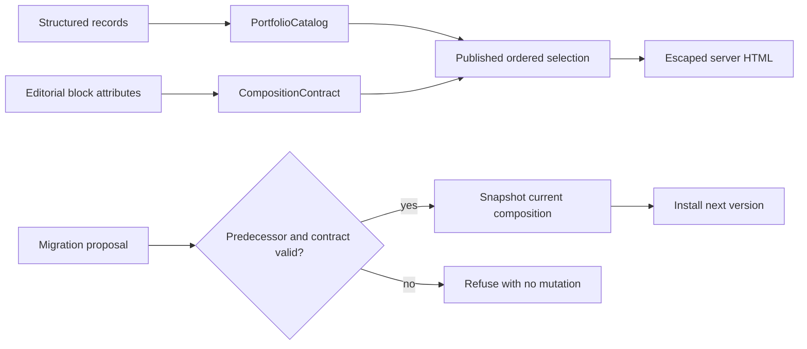

# Dynamic WordPress Blocks and Content Models

An original, dependency-free PHP demonstration of a content model that stays separate from rendering, plus a guarded page-composition migration with recovery snapshots.

**Technical showcase · Runnable educational demo · Anonymized**

PHP 8.3 | WordPress-oriented architecture | Dynamic rendering | Optimistic concurrency

This repository does not contain client source, records, names, domains, identifiers, or assets. The small executable was written for this public repository; the original implementation remains private.

## Quick start

From the repository root:

```bash
php tests/run.php
php demo/run.php
```

Run one or more tests by case-name substring:

```bash
php tests/run.php migration
```

A filter that matches no cases exits with status `2`:

```bash
php tests/run.php no-such-case
```

No Composer install, database, web server, or WordPress installation is required.

## Sample output

```text
== Guarded migration ==
Applied version 13; snapshots: 1

== Stale writer ==
REFUSED: Expected predecessor version 12, but current version is 13; refusing stale write.
Current version remains 13; snapshots remain 1.
```

The demo also prints escaped HTML generated from fabricated structured records.

## What the executable demonstrates

- Structured portfolio records are owned by a catalog rather than embedded in page markup.
- Selection follows explicit editorial ID order.
- Draft and private references fail closed; missing IDs are errors rather than omissions.
- An optional taxonomy term filters the already validated selection while preserving relative order.
- A renderer accepts one bounded block contract and escapes all record/editor text for HTML output.
- Composition proposals reject unknown blocks, unknown attributes, missing fields, duplicate IDs, and wrong types.
- A migration validates its full block contract and resolves every reference against the same public-content catalog before mutation, checks the exact predecessor version, snapshots the predecessor, then applies the successor.
- A stale proposal changes neither composition nor snapshot history.
- Snapshot restoration is implemented as another guarded forward version, preserving the state being replaced.

## File map

| Path | Responsibility |
| --- | --- |
| `src/PortfolioDemo.php` | Record contracts, published selection, rendering, block validation, versioned migration, snapshot recovery |
| `tests/run.php` | Dependency-free behavioral test runner with optional substring filtering |
| `demo/run.php` | Visible render, successful migration, and non-crashing stale-write refusal |
| `docs/engineering.md` | Contracts, data flow, ownership, migration states, failures, and trade-offs |
| `docs/wordpress-mapping.md` | Explicit mapping from the in-memory adapter to real WordPress responsibilities |
| `docs/scope.md` | Evidence, privacy, and implementation boundaries |

## Architecture



The executable uses an in-memory adapter to make the rules inspectable and runnable. It deliberately does **not** implement WordPress persistence, database transaction/concurrency guarantees, editor UI, authentication/capability checks, nonces, native REST endpoints, media handling, or deployment automation. See [WordPress mapping](docs/wordpress-mapping.md) for the production adapter boundary.

## Documentation

- [Engineering contracts and decisions](docs/engineering.md)
- [WordPress integration mapping](docs/wordpress-mapping.md)
- [Scope and evidence boundaries](docs/scope.md)

## Public/private boundary

This is an original educational model of engineering patterns used in content-rich WordPress work. It is not the original private implementation, an installable plugin, a theme, or proof of a production deployment. It makes no performance, business-impact, or production-concurrency claim.