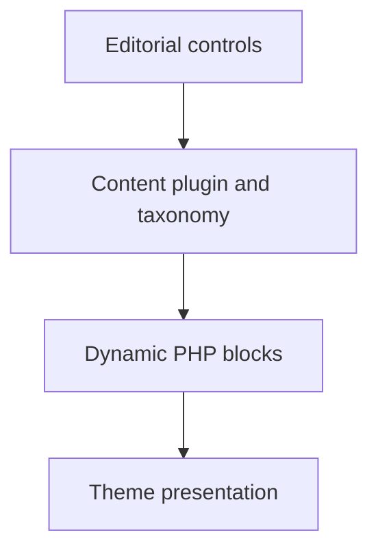

# Dynamic WordPress Blocks and Content Models

A dynamic block system with a companion content plugin, separating structured records from the theme that displays them.

**Technical showcase · Documentation only · Anonymized**

WordPress | PHP | Gutenberg | REST API | JavaScript | WP-CLI

## Engineering problem

A content-rich site needs flexible presentation without binding its records to a single theme. Editorial controls also need to cover the real rendered fields, rather than exposing settings that never affect the page.

## Implementation scope

- Registered server-rendered blocks from metadata and supplied shared editor controls.
- Moved structured records, taxonomy and post metadata into a companion plugin independent of the theme.
- Implemented block-editor and classic-editor controls with media selection, capability checks, nonce verification and sanitization.
- Rendered taxonomy-driven collections with escaped details, lazy images and carousel accessibility semantics.
- Prepared content migrations with predecessor checks, asset checks, backups and explicit failure handling.

## Architecture at a glance

The following is an illustrative technical flow, not a client screenshot or a deployment topology.

## Evidence and delivery boundary

Implemented candidate; deployment of the inspected candidate is not asserted.

Source inspection supports the content model, rendering paths and migration guards. Candidate source and deployed snapshots are not treated as interchangeable evidence.

## Read more

- [Engineering decisions](docs/engineering.md)
- [Scope and evidence boundaries](docs/scope.md)

> This repository describes verified implementation work at a technical level. Original source, identities, business data and visual assets are intentionally omitted. It is not an installable application or a claim that the original private implementation is open source.
